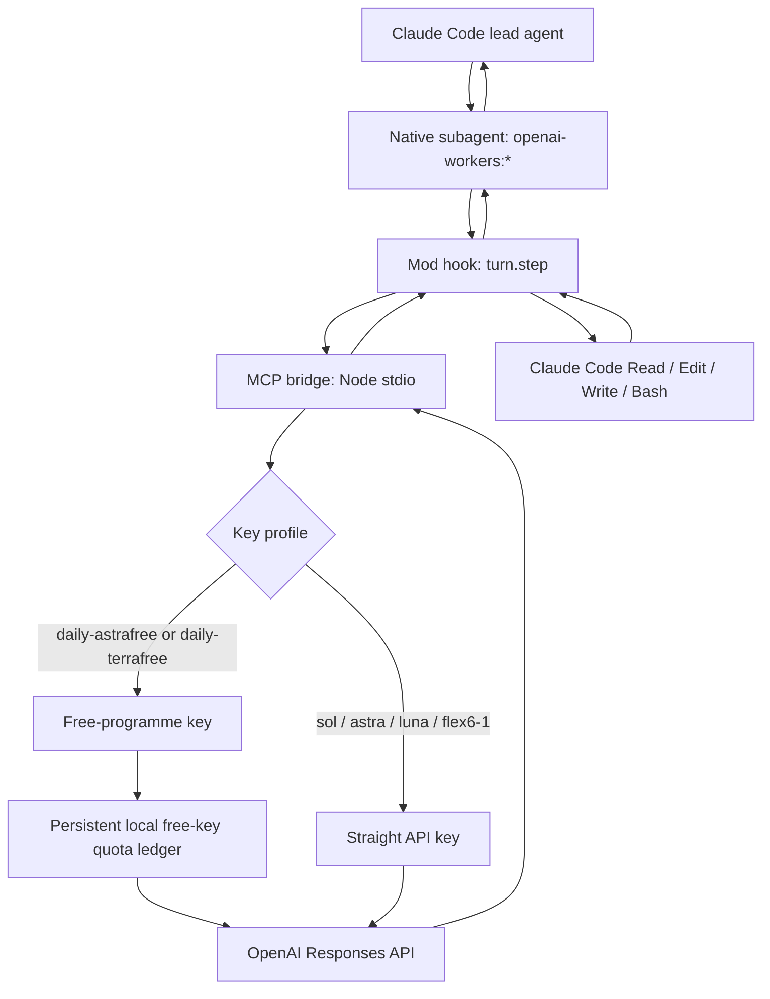

# Architecture and security model

[← Overview](../README.md) · [Developer guide →](../CONTRIBUTING.md)

## Component flow

## Source map

| Path | Responsibility |
|---|---|
| `.claude-plugin/marketplace.json` | Marketplace identifier and plugin source |
| `plugins/openai-workers/.claude-plugin/plugin.json` | Plugin metadata |
| `plugins/openai-workers/hooks/register.js` | Registers six agents and `/openai-workers`; redirects only matching native subagent model steps |
| `plugins/openai-workers/hooks/step.js` | Converts tool-use segments and session continuation into Responses API input |
| `plugins/openai-workers/hooks/tools.js` | Strict allowlist for model-requested Claude Code tools |
| `plugins/openai-workers/bridge/server.mjs` | MCP stdio protocol, request dispatch, paginated responses |
| `plugins/openai-workers/bridge/openai.mjs` | OpenAI Responses HTTP requests, credentials, normalization and estimated costs |
| `plugins/openai-workers/bridge/usage.mjs` | Persistent, locked, cross-process free-key quota ledger |
| `plugins/openai-workers/scripts/*.ps1` | Windows DPAPI and user environment helper scripts |

## Trust and permission boundaries

- **Claude Code → OpenAI:** delegated instructions, project-specific context, tool results and relevant repository content leave your machine for OpenAI. Only delegate appropriate repositories.
- **OpenAI → Claude Code tools:** the model may request `Read`, `Edit`, `Write` and `Bash` but cannot invoke them directly through this bridge; Claude Code performs its normal permission checks.
- **Keys:** stored separately with Windows DPAPI or sourced from the process environment. The bridge never returns credential values to `/openai-workers`.
- **Network:** HTTPS calls go to `https://api.openai.com/v1/responses` and related polling/cancel URLs. The bridge uses stored/background Responses to allow continuation.
- **MCP:** the local bridge runs as a Node stdio child process; avoid blindly approving all actions from untrusted plugins.

## Failure behaviour

- Missing/wrong key, quota ledger corruption, invalid tier and transport/API errors stop the specific subagent **without silently sending the work back to the Claude model**.
- The complimentary key is never automatically replaced with the straight key.
- Ambiguous network failures retain an estimated reservation to avoid undercounting.
- A stuck or corrupted local ledger affects the two free-key workers; it does not gate straight-key workers.
- All cost values are estimates; OpenAI account charges are authoritative.

## Privacy and data retention

The OpenAI API request uses `background: true` and `store: true`; model-side and API-side retention policies apply. The free-programme key may be associated with data-sharing eligibility or other terms. Review both providers' privacy and organizational policies before enabling delegation for proprietary or regulated material. The plugin's usage ledger stores token counts and response IDs rather than source files or keys.

## Versioning

This repository initially imports the tested **v0.5.0** two-key plugin, with no changes to quota routing or model request semantics. If Claude Code changes its mods API, validate on the supported CLI version and extend the automated tests before publishing compatibility claims.

## Claude Desktop extension

`bridge/desktop-server.mjs` adds a second MCP stdio interface that exposes a **fixed allowlist** of six text-only OpenAI worker profiles. It calls the existing `bridge/server.mjs` `dispatch` path for creation, polling, cancellations and quota ledger accounting. It never exposes the underlying arbitrary `create` bridge tool directly to desktop Chat, never grants local file/shell tools and never returns key material.

The `.mcpb` archive packages the server, OpenAI client, usage ledger, worker profiles and DPAPI reader without external Node dependencies. Sensitive installer configuration is delivered through environment variables (`OPENAI_API_KEY` and `OPENAI_FREE_API_KEY`). An unset key can fall back to its DPAPI store on Windows.

The native Claude Code mod's worker profile table and desktop Chat worker profile table are imported from `bridge/workers.mjs` to prevent accidental model/tier drift. Both modes share the same `free-usage-ledger.json` path and locking protocol for free-key requests.

**Important boundary:** Code-tab mods use Claude Code's tool authorization. Regular Chat-tab MCP calls ask a remote OpenAI model for text; they do not authorize the OpenAI worker to independently inspect or edit files.
